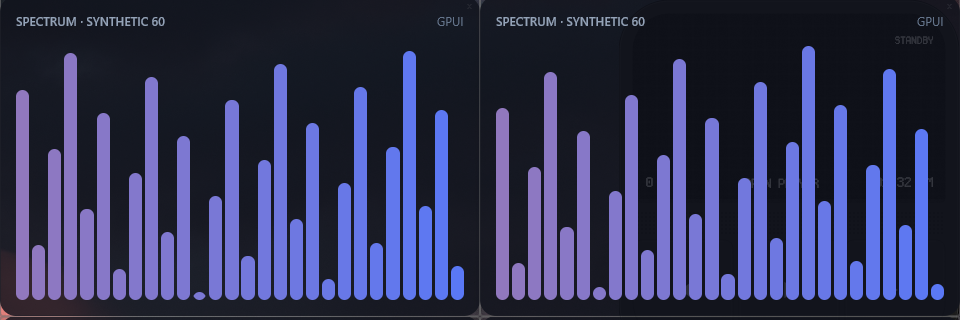

# GPUI runtime spike

Question behind [ADR 0019](../../docs/adr/0019-one-gpui-runtime-process.md):
what do Weaver-shaped Widgets cost as windows of one
[GPUI](https://github.com/zed-industries/zed/tree/main/crates/gpui) process,
compared with today's stack (one `weaver-widget` process per Widget plus the
shared `weaver-renderer`)?

## Machine and builds

Measured 2026-10-14. Windows 11 10.0.26200, AMD Ryzen 7 5800X (16 logical
cores), NVIDIA GeForce RTX 4070 (driver 32.0.16.1088), one 1920x1080 display
at 143 Hz and 96 DPI. Ordinary desktop load in the background (browsers,
Spotify, Rainmeter, sync clients), which is why every CPU figure is a range.

- GPUI: Zed `2dcc4cc0`, `cargo build --release`, dependencies pinned by
  [`Cargo.lock`](Cargo.lock).
- Weaver: `origin/master` at `e583ec8`, runtime, host and renderer built with
  `-Doptimize=ReleaseFast`.

## Scene

`examples/m4b-synthetic`: a 480x320 card, two text labels, and 28 rounded bars
redrawn at 60 fps. `--mode canvas` in [`src/main.rs`](src/main.rs) ports it to
GPUI with the same bar math and draws the bars with `paint_quad`.
[`weaver-baseline.ps1`](weaver-baseline.ps1) installs ten tiled copies of the
real example into a scratch `LOCALAPPDATA`. Both stacks use the same gapless
4x3 tiling of 480x320 windows. Runs alternated between stacks in one session.

## Counters

Same as [`docs/m4a-results.md`](../../docs/m4a-results.md): private working
set is `Win32_PerfFormattedData_PerfProc_Process.WorkingSetPrivate`, private
bytes is `PrivateMemorySize64`, CPU is a 15-second `TotalProcessorTime` delta
as a percent of one logical core. Every process's CPU endpoint is read
together with the clock before any memory counter is queried. Weaver totals
are renderer plus Widgets; `weaverd` (0.3–0.5%, 1.8 MiB) is excluded.

## Results: ten Widgets

| Stack | Layer | Trials | CPU | Private WS | Private bytes | Threads | FPS per window |
|---|---|---:|---:|---:|---:|---:|---:|
| weaver `e583ec8` | normal | 3 | 33.1–36.5% | 130.4 MiB | 572 MiB | 119–126 | 60 (presents) |
| weaver `e583ec8` | desktop | 3 | 35.0–41.1% | 130.4 MiB | 572 MiB | 119–124 | 60 (presents) |
| GPUI, one process | normal | 3 | 16.3–25.7% | 28.3–28.6 MiB | 120–122 MiB | 69–70 | 57.8–58.4 (renders) |
| GPUI, one process | desktop | 5 | 20.6–38.8% | 28.2–28.6 MiB | 120–121 MiB | 69–70 | 57.4–58.4 (renders) |

Memory is the robust result: 28 MiB against 130 MiB private working set, and
120 MiB against 572 MiB private bytes, with no overlap between any trials. CPU
is lower for GPUI on the median (normal 16.7% vs 36.0%, desktop 31.3% vs
37.4%), but the desktop-layer ranges overlap. Weaver's renderer process alone
used 14–18% of one core in those trials.

## Where the memory goes

Within GPUI, process topology explains most of it: three windows cost
18.2 MiB in one process and 43.5 MiB (198 threads) as three processes, and
GPUI went from 14.4 MiB at one window to 28.5 MiB at ten, about 1.6 MiB per
added window. Weaver's per-Widget process is a steady 11.4 MiB private
working set and 50.6 MiB private bytes in every trial above, but on Weaver's
side topology is the smaller part: run as threads of one process, ten Widgets
still hold 121–124 MiB. Most of a Widget's cost is state it touches at
startup; see [`spikes/native-one-process`](../native-one-process/README.md).

Those GPUI scaling runs (1, 3 and 10 windows; three single-window processes)
were taken earlier the same day with the original sampling order, which read
memory counters before the final CPU sample. Their memory figures are
unaffected; their CPU figures are not reported here.

## What differs between the two sides

- GPUI computes the bars in Rust inside `render()` and rebuilds its element
  tree every frame. Weaver runs the same math in a JS `onFrame` callback,
  validates the command buffer, and keeps layout off canvas-only frames. A
  real GPUI runtime would carry the JS work over.
- GPUI frames are timer-driven `render()` calls counted per window; Weaver
  frames are completed presents.
- `--desktop` applies `WS_EX_NOACTIVATE`, `WS_EX_TOOLWINDOW` and
  `HWND_BOTTOM`. Weaver's WorkerW lookup (`attachDesktopWindow` in the Native
  fork's `webview2_host.cpp`) finds nothing on this Windows build, where the
  wallpaper WorkerW is a child of Progman, so neither stack was parented to
  the desktop. In an earlier run with the extended styles only, ten GPUI
  Widgets stayed on the desktop through Win+D with no taskbar buttons:

  

## Other modes

- `--mode viz` lays out 32 flex `div` bars with Taffy every frame instead of
  painting quads: 10 windows, 29.6 MiB.
- `--mode clock` (220x90 card, text changes once a second): 14.1 MiB in one
  process. This is not an idle-zero measurement; the spike also wakes every
  five seconds to print counters.

## Not measured

macOS, click-through, idle-zero, input, multiple monitors, sleep/resume,
graphics device loss, and per-Widget billing in one process.

## Reproduce

```powershell
cargo build --release
.\measure.ps1 -Mode canvas -Windows 10
.\measure.ps1 -Mode canvas -Windows 10 -Extra '--desktop'
# From a ReleaseFast-built Weaver checkout containing this folder:
.\weaver-baseline.ps1 -Widgets 10 -Trials 3 -Layer normal
```

Don't drive Win+D from a script without saving the window list first: a
synthetic Win+D lost its toggle state and had to be undone window by window.
